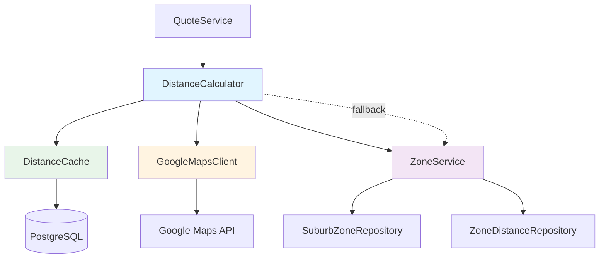
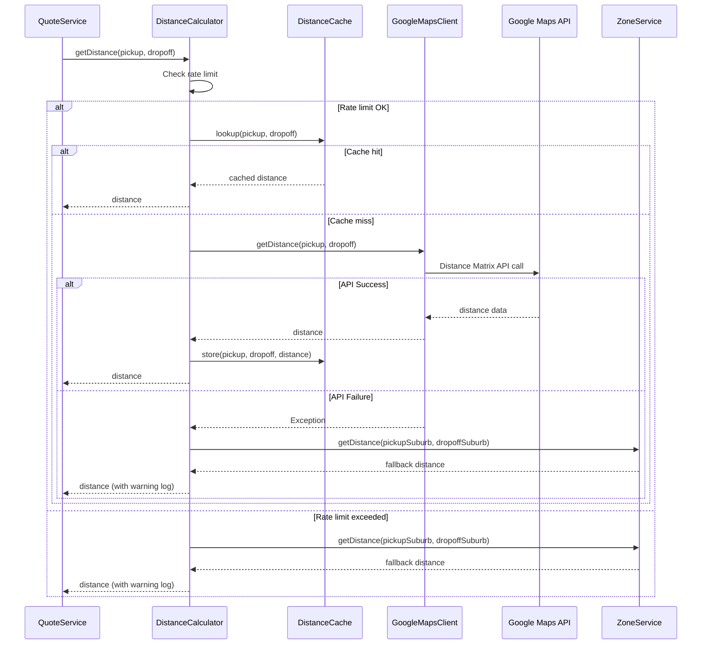
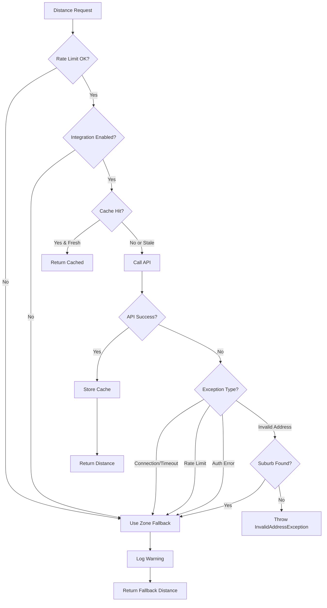

# Technical Design: Google Maps Distance Matrix API Integration

## Overview

This design specifies the integration of Google Maps Distance Matrix API into the existing transport booking system to replace zone-based distance calculations with real-time, address-based road distance calculations. The system maintains backward compatibility with the existing zone-based system, which serves as a fallback mechanism during API failures or rate limit conditions.

The integration introduces three new primary components:
- **DistanceCalculator**: Orchestrates distance calculation logic with intelligent fallback
- **GoogleMapsClient**: Handles HTTP communication with Google Maps Distance Matrix API
- **DistanceCache**: Provides persistent caching to minimize API costs and improve performance

The design ensures that existing functionality continues to work while gradually migrating to API-based distance calculations where full addresses are available.

## Architecture

### Component Interaction



### Request Flow Diagram



## Components and Interfaces

### 1. DistanceCalculator Service

**Purpose**: Primary orchestration service that coordinates distance calculation using Google Maps API with intelligent caching and fallback to zone-based system.

**Location**: `com.moveandtransportsa.booking.service.DistanceCalculator`

**Dependencies**:
- `GoogleMapsClient`: API communication
- `DistanceCache`: Response caching
- `ZoneService`: Fallback distance calculation
- `GoogleMapsConfig`: Configuration properties
- `MeterRegistry`: Metrics collection

**Key Methods**:

```java
public interface DistanceCalculator {
    /**
     * Calculates distance between two addresses using Google Maps API.
     * Falls back to zone-based calculation on API failure.
     * 
     * @param pickup Full pickup address
     * @param dropoff Full dropoff address
     * @return Distance in kilometers with scale 2
     * @throws InvalidAddressException if both API and zone lookup fail
     */
    BigDecimal getDistance(Address pickup, Address dropoff);
    
    /**
     * Calculates distance using zone-based system (backward compatibility).
     * 
     * @param pickupSuburb Pickup suburb name
     * @param dropoffSuburb Dropoff suburb name
     * @return Distance in kilometers
     * @throws SuburbNotFoundException if suburbs not found
     */
    BigDecimal getDistance(String pickupSuburb, String dropoffSuburb);
}
```

**Internal Logic**:

1. **Rate Limiting Check**:
   - Check if current minute request count < configured max
   - If exceeded, log warning and use fallback immediately

2. **Address Validation**:
   - Return 0.00 if pickup equals dropoff (after normalization)
   
3. **Cache Lookup**:
   - Normalize addresses (lowercase, trim whitespace)
   - Generate cache key
   - Check cache with bidirectional support
   - Return cached value if fresh (<7 days)

4. **API Call**:
   - Invoke GoogleMapsClient with formatted addresses
   - On success: store in cache, increment success metric, return distance
   - On failure: catch exception, log warning, invoke fallback

5. **Fallback Logic**:
   - Extract suburb from address
   - Call ZoneService.getDistance(suburb, suburb)
   - Increment fallback metric with reason label
   - Return fallback distance

**Metrics**:
- `google_maps_api_calls_total{status}` - Counter
- `distance_cache_hits_total` - Counter
- `distance_cache_misses_total` - Counter
- `distance_fallback_total{reason}` - Counter

### 2. GoogleMapsClient Service

**Purpose**: Handles HTTP communication with Google Maps Distance Matrix API including request construction, response parsing, and error handling.

**Location**: `com.moveandtransportsa.booking.service.GoogleMapsClient`

**Dependencies**:
- `RestTemplate` or `WebClient`: HTTP client
- `GoogleMapsConfig`: Configuration (API key, timeout)
- `MeterRegistry`: Response time metrics

**Key Methods**:

```java
public interface GoogleMapsClient {
    /**
     * Calls Google Maps Distance Matrix API to get road distance.
     * 
     * @param origin Full origin address
     * @param destination Full destination address
     * @return Distance in kilometers with scale 2
     * @throws InvalidAddressException if address not found
     * @throws RateLimitExceededException if quota exceeded
     * @throws ApiAuthenticationException if API key invalid
     * @throws ApiConnectionException if network failure
     * @throws ApiResponseException if response malformed
     */
    BigDecimal getDistance(String origin, String destination);
}
```

**Request Construction**:
- **Endpoint**: `https://maps.googleapis.com/maps/api/distancematrix/json`
- **Method**: GET
- **Parameters**:
  - `origins`: URL-encoded origin address
  - `destinations`: URL-encoded destination address
  - `mode`: `driving`
  - `units`: `metric`
  - `key`: API key from configuration
- **Timeout**: Configurable (default 5 seconds)

**Response Parsing**:

Expected successful response structure:
```json
{
  "status": "OK",
  "rows": [
    {
      "elements": [
        {
          "status": "OK",
          "distance": {
            "value": 12345,
            "text": "12.3 km"
          },
          "duration": {
            "value": 900,
            "text": "15 mins"
          }
        }
      ]
    }
  ]
}
```

**Error Handling Matrix**:

| API Status | Element Status | Action | Exception |
|------------|---------------|--------|-----------|
| OK | OK | Extract distance.value, convert to km | None |
| OK | NOT_FOUND | Log error | InvalidAddressException |
| OK | ZERO_RESULTS | Log error | InvalidAddressException |
| OVER_QUERY_LIMIT | - | Log warning | RateLimitExceededException |
| REQUEST_DENIED | - | Log error | ApiAuthenticationException |
| INVALID_REQUEST | - | Log error | InvalidRequestException |
| Network timeout | - | Log error | ApiConnectionException |
| Malformed JSON | - | Log error | ApiResponseException |

**Response Validation**:
1. Check response body is valid JSON
2. Check `status` field exists
3. Check `rows` array exists and not empty
4. Check `elements` array exists and not empty
5. Check `distance.value` >= 0
6. Warn if `distance.value` > 5,000,000 meters

**Metrics**:
- `google_maps_api_duration_seconds` - Histogram

### 3. DistanceCache Service

**Purpose**: Provides persistent caching of distance calculations with TTL management and bidirectional lookup support.

**Location**: `com.moveandtransportsa.booking.service.DistanceCache`

**Dependencies**:
- `DistanceCacheRepository`: JPA repository
- `GoogleMapsConfig`: Cache configuration (TTL, enabled flag)

**Key Methods**:

```java
public interface DistanceCache {
    /**
     * Looks up cached distance for address pair.
     * Supports bidirectional lookup: cache(A,B) == cache(B,A)
     * Updates accessed_at timestamp on hit.
     * 
     * @param pickup Normalized pickup address
     * @param dropoff Normalized dropoff address
     * @return Optional containing distance if found and fresh
     */
    Optional<BigDecimal> lookup(String pickup, String dropoff);
    
    /**
     * Stores distance calculation result in cache.
     * 
     * @param pickup Normalized pickup address
     * @param dropoff Normalized dropoff address
     * @param distanceKm Distance value to cache
     */
    void store(String pickup, String dropoff, BigDecimal distanceKm);
    
    /**
     * Normalizes address for consistent cache key generation.
     * Converts to lowercase and removes extra whitespace.
     * 
     * @param address Raw address string
     * @return Normalized address
     */
    String normalize(String address);
}
```

**Cache Key Strategy**:
- Normalize both addresses (lowercase, trim)
- Sort addresses alphabetically to ensure bidirectional lookup
- Use sorted pair as composite key

**TTL Management**:
- Check `created_at` timestamp on lookup
- Invalidate if age > configured TTL (default 7 days)
- Update `accessed_at` on each successful lookup

**Scheduled Cleanup**:
```java
@Scheduled(cron = "0 0 2 * * *") // 2 AM daily
public void cleanupStaleEntries() {
    // Delete entries where accessed_at < 30 days ago
}
```

### 4. GoogleMapsConfig Configuration

**Purpose**: Type-safe configuration properties for Google Maps integration.

**Location**: `com.moveandtransportsa.booking.config.GoogleMapsConfig`

**Pattern**: Following existing `JwtConfig` pattern with `@ConfigurationProperties`

**Properties**:

```java
@Configuration
@ConfigurationProperties(prefix = "google.maps")
@Getter
@Setter
public class GoogleMapsConfig {
    /**
     * Google Maps API key.
     * Required when enabled=true.
     */
    private String apiKey;
    
    /**
     * Enable/disable Google Maps integration.
     * When false, always use zone-based fallback.
     * Default: true
     */
    private boolean enabled = true;
    
    /**
     * API request timeout in seconds.
     * Default: 5
     */
    private int timeoutSeconds = 5;
    
    /**
     * Maximum API requests per minute.
     * Used for rate limiting.
     * Default: 100
     */
    private int maxRequestsPerMinute = 100;
    
    /**
     * Enable/disable response caching.
     * Default: true
     */
    private boolean cacheEnabled = true;
    
    /**
     * Cache entry time-to-live in days.
     * Default: 7
     */
    private int cacheTtlDays = 7;
    
    @PostConstruct
    public void validate() {
        if (enabled && (apiKey == null || apiKey.isBlank())) {
            throw new ApiKeyNotConfiguredException(
                "Google Maps API key must be configured when google.maps.enabled=true"
            );
        }
    }
}
```

**Configuration in application.yml**:

```yaml
google:
  maps:
    api-key: ${GOOGLE_MAPS_API_KEY:}
    enabled: true
    timeout-seconds: 5
    max-requests-per-minute: 100
    cache-enabled: true
    cache-ttl-days: 7
```

### 5. Address Value Object

**Purpose**: Represents a complete address for distance calculation.

**Location**: `com.moveandtransportsa.booking.dto.Address`

**Structure**:

```java
public record Address(
    String addressLine,
    String suburb,
    String city
) {
    /**
     * Formats address for Google Maps API.
     * Example: "123 Main St, Johannesburg, Gauteng"
     */
    public String toFormattedString() {
        return String.join(", ", addressLine, suburb, city);
    }
    
    /**
     * Extracts suburb for fallback zone lookup.
     */
    public String getSuburb() {
        return suburb;
    }
}
```

**Factory Method** (for converting from BookingAddress):

```java
public static Address from(BookingAddress bookingAddress) {
    return new Address(
        bookingAddress.getAddressLine(),
        bookingAddress.getSuburb(),
        bookingAddress.getCity()
    );
}
```

## Data Models

### DistanceCache Entity

**Table**: `distance_cache`

**Entity Class**: `com.moveandtransportsa.booking.domain.distance.DistanceCache`

**Schema**:

```sql
CREATE TABLE distance_cache (
    id BIGSERIAL PRIMARY KEY,
    pickup_address VARCHAR(500) NOT NULL,
    dropoff_address VARCHAR(500) NOT NULL,
    distance_km NUMERIC(10, 2) NOT NULL,
    created_at TIMESTAMP NOT NULL,
    accessed_at TIMESTAMP NOT NULL,
    CONSTRAINT distance_cache_unique UNIQUE (pickup_address, dropoff_address),
    CONSTRAINT distance_km_positive CHECK (distance_km >= 0)
);

CREATE INDEX idx_distance_cache_addresses ON distance_cache (pickup_address, dropoff_address);
CREATE INDEX idx_distance_cache_accessed ON distance_cache (accessed_at);
```

**JPA Entity**:

```java
@Entity
@Table(
    name = "distance_cache",
    uniqueConstraints = @UniqueConstraint(
        columnNames = {"pickup_address", "dropoff_address"}
    )
)
@Data
@NoArgsConstructor
@AllArgsConstructor
@Builder
public class DistanceCacheEntity {
    
    @Id
    @GeneratedValue(strategy = GenerationType.IDENTITY)
    private Long id;
    
    @Column(name = "pickup_address", nullable = false, length = 500)
    private String pickupAddress;
    
    @Column(name = "dropoff_address", nullable = false, length = 500)
    private String dropoffAddress;
    
    @Column(name = "distance_km", nullable = false, precision = 10, scale = 2)
    private BigDecimal distanceKm;
    
    @Column(name = "created_at", nullable = false, updatable = false)
    private Instant createdAt;
    
    @Column(name = "accessed_at", nullable = false)
    private Instant accessedAt;
}
```

**Repository**:

```java
public interface DistanceCacheRepository extends JpaRepository<DistanceCacheEntity, Long> {
    
    @Query("""
        SELECT dc FROM DistanceCacheEntity dc 
        WHERE (dc.pickupAddress = :addr1 AND dc.dropoffAddress = :addr2)
           OR (dc.pickupAddress = :addr2 AND dc.dropoffAddress = :addr1)
        """)
    Optional<DistanceCacheEntity> findByAddressPair(
        @Param("addr1") String address1,
        @Param("addr2") String address2
    );
    
    @Modifying
    @Query("DELETE FROM DistanceCacheEntity dc WHERE dc.accessedAt < :cutoffDate")
    int deleteStaleEntries(@Param("cutoffDate") Instant cutoffDate);
}
```

## Exception Hierarchy

**New Exceptions**: `com.moveandtransportsa.booking.exception.distance`

```java
// Base exception for distance calculation failures
public class DistanceCalculationException extends RuntimeException {
    public DistanceCalculationException(String message) {
        super(message);
    }
    public DistanceCalculationException(String message, Throwable cause) {
        super(message, cause);
    }
}

// Address not found in Google Maps
public class InvalidAddressException extends DistanceCalculationException {
    public InvalidAddressException(String address) {
        super("Address not found: " + address);
    }
}

// API rate limit exceeded
public class RateLimitExceededException extends DistanceCalculationException {
    public RateLimitExceededException() {
        super("Google Maps API rate limit exceeded");
    }
}

// API authentication failure
public class ApiAuthenticationException extends DistanceCalculationException {
    public ApiAuthenticationException() {
        super("Google Maps API authentication failed - check API key");
    }
}

// Network or timeout error
public class ApiConnectionException extends DistanceCalculationException {
    public ApiConnectionException(Throwable cause) {
        super("Failed to connect to Google Maps API", cause);
    }
}

// Malformed API response
public class ApiResponseException extends DistanceCalculationException {
    public ApiResponseException(String message) {
        super("Invalid API response: " + message);
    }
}

// Invalid API request
public class InvalidRequestException extends DistanceCalculationException {
    public InvalidRequestException(String message) {
        super("Invalid API request: " + message);
    }
}

// API key not configured
public class ApiKeyNotConfiguredException extends RuntimeException {
    public ApiKeyNotConfiguredException(String message) {
        super(message);
    }
}
```

## Error Handling Flow

### Decision Tree



### Exception Handling Strategy

**In DistanceCalculator**:

```java
public BigDecimal getDistance(Address pickup, Address dropoff) {
    try {
        // Rate limiting check
        if (!checkRateLimit()) {
            return fallbackToZone(pickup, dropoff, "rate_limit");
        }
        
        // Cache lookup
        Optional<BigDecimal> cached = cache.lookup(
            cache.normalize(pickup.toFormattedString()),
            cache.normalize(dropoff.toFormattedString())
        );
        if (cached.isPresent()) {
            meterRegistry.counter("distance_cache_hits_total").increment();
            return cached.get();
        }
        meterRegistry.counter("distance_cache_misses_total").increment();
        
        // API call
        BigDecimal distance = googleMapsClient.getDistance(
            pickup.toFormattedString(),
            dropoff.toFormattedString()
        );
        
        // Store in cache
        cache.store(
            cache.normalize(pickup.toFormattedString()),
            cache.normalize(dropoff.toFormattedString()),
            distance
        );
        
        return distance;
        
    } catch (ApiConnectionException | RateLimitExceededException | ApiAuthenticationException e) {
        log.warn("Google Maps API unavailable, using zone fallback: {}", e.getMessage());
        return fallbackToZone(pickup, dropoff, e.getClass().getSimpleName());
        
    } catch (InvalidAddressException e) {
        log.warn("Address not found in Google Maps, attempting zone fallback: {}", e.getMessage());
        try {
            return fallbackToZone(pickup, dropoff, "invalid_address");
        } catch (SuburbNotFoundException suburbException) {
            throw new InvalidAddressException(
                "Address not found in Google Maps and suburb not found in zone system: " +
                pickup.getSuburb() + " or " + dropoff.getSuburb()
            );
        }
    }
}

private BigDecimal fallbackToZone(Address pickup, Address dropoff, String reason) {
    meterRegistry.counter("distance_fallback_total", "reason", reason).increment();
    log.warn("Falling back to zone-based distance: pickup={}, dropoff={}, reason={}",
        pickup.getSuburb(), dropoff.getSuburb(), reason);
    return zoneService.getDistance(pickup.getSuburb(), dropoff.getSuburb());
}
```

## Integration Points

### 1. QuoteService Integration

**Modification Strategy**: Maintain backward compatibility while supporting new address-based flow.

**Updated QuoteService**:

```java
@Service
@RequiredArgsConstructor
public class QuoteService {
    
    private final DistanceCalculator distanceCalculator; // Changed from ZoneService
    private final PricingService pricingService;
    
    /**
     * Existing method - maintains backward compatibility
     */
    public QuoteResponse calculate(QuoteRequest req) {
        // Delegates to zone-based calculation
        BigDecimal distanceKm = distanceCalculator.getDistance(
            req.pickupSuburb(), 
            req.dropoffSuburb()
        );
        
        // Rest of pricing logic unchanged...
    }
    
    /**
     * New method - uses full addresses
     */
    public QuoteResponse calculateWithAddresses(QuoteRequestWithAddresses req) {
        Address pickup = new Address(
            req.pickupAddressLine(),
            req.pickupSuburb(),
            req.pickupCity()
        );
        Address dropoff = new Address(
            req.dropoffAddressLine(),
            req.dropoffSuburb(),
            req.dropoffCity()
        );
        
        // Uses Google Maps with fallback
        BigDecimal distanceKm = distanceCalculator.getDistance(pickup, dropoff);
        
        PricingRuleResponse rule = pricingService.getActiveRule(
            req.vehicleTypeId(), 
            LocalDate.now()
        );
        
        // Rest of pricing logic...
    }
}
```

**New DTOs**:

```java
public record QuoteRequestWithAddresses(
    String pickupAddressLine,
    String pickupSuburb,
    String pickupCity,
    String dropoffAddressLine,
    String dropoffSuburb,
    String dropoffCity,
    Long vehicleTypeId,
    int helpers,
    boolean stairs,
    LocalDate serviceDate,
    LocalTime serviceTime
) {}
```

### 2. BookingService Integration

**Future Enhancement**: When creating bookings with full address data, the system can automatically use the Google Maps distance.

**Strategy**:
- Extract addresses from `BookingAddress` entities
- Convert to `Address` value objects
- Calculate distance using `DistanceCalculator.getDistance(Address, Address)`
- Store calculated distance in `Booking` entity for quote consistency

### 3. ZoneService Integration

**No Changes Required**: ZoneService remains unchanged and continues to function as fallback mechanism.

**Integration Point**: DistanceCalculator calls ZoneService methods when fallback is needed.

## Caching Strategy

### Multi-Level Caching

**Level 1 - Application Cache** (Optional Future Enhancement):
- In-memory cache using Caffeine or Spring Cache
- Short TTL (1 hour)
- Reduces database queries for frequent routes

**Level 2 - Database Cache** (Current Design):
- Persistent PostgreSQL storage
- Longer TTL (7 days)
- Survives application restarts
- Shared across multiple instances

### Cache Key Generation

```java
public String generateCacheKey(String addr1, String addr2) {
    String normalized1 = normalize(addr1);
    String normalized2 = normalize(addr2);
    
    // Sort for bidirectional support
    if (normalized1.compareTo(normalized2) > 0) {
        return normalized2 + "|" + normalized1;
    }
    return normalized1 + "|" + normalized2;
}

public String normalize(String address) {
    return address.trim().toLowerCase();
}
```

### Cache Invalidation

**Time-Based**:
- Entries older than `cacheTtlDays` considered stale on lookup
- Not automatically deleted (allows historical data)

**Access-Based Cleanup**:
- Daily scheduled job deletes entries not accessed in 30 days
- Runs at 2 AM to minimize impact
- Uses `accessed_at` timestamp

**Manual Invalidation** (Future Enhancement):
- Admin endpoint to clear specific routes
- Useful for data corrections

### Cache Metrics

```java
// Expose cache statistics through Actuator
@Component
public class CacheMetrics {
    
    private final DistanceCacheRepository repository;
    private final MeterRegistry registry;
    
    @PostConstruct
    public void registerMetrics() {
        Gauge.builder("distance_cache_size", repository, r -> r.count())
            .description("Total number of cached distance entries")
            .register(registry);
    }
}
```

## Configuration Properties Structure

### Complete Configuration Example

```yaml
google:
  maps:
    # API key - required when enabled=true
    # Can be provided via environment variable GOOGLE_MAPS_API_KEY
    api-key: ${GOOGLE_MAPS_API_KEY:}
    
    # Enable/disable integration (default: true)
    # Set to false to always use zone-based fallback
    enabled: true
    
    # API request timeout in seconds (default: 5)
    timeout-seconds: 5
    
    # Rate limiting - max requests per minute (default: 100)
    # Prevents excessive API costs
    max-requests-per-minute: 100
    
    # Enable response caching (default: true)
    cache-enabled: true
    
    # Cache entry TTL in days (default: 7)
    # Entries older than this are considered stale
    cache-ttl-days: 7

# Expose metrics for monitoring
management:
  endpoints:
    web:
      exposure:
        include: health,info,metrics
  metrics:
    tags:
      application: transport-booking
```

### Environment-Specific Configuration

**Development** (`application.yml`):
```yaml
google:
  maps:
    enabled: true
    timeout-seconds: 10
    cache-enabled: true
```

**Production** (`application-prod.yml`):
```yaml
google:
  maps:
    enabled: true
    timeout-seconds: 5
    max-requests-per-minute: 100
    cache-enabled: true
    cache-ttl-days: 7
```

**Testing** (`application-test.yml`):
```yaml
google:
  maps:
    enabled: false  # Use zone fallback in tests
    cache-enabled: false
```

## Correctness Properties

*A property is a characteristic or behavior that should hold true across all valid executions of a system—essentially, a formal statement about what the system should do. Properties serve as the bridge between human-readable specifications and machine-verifiable correctness guarantees.*

### Property 1: Address Normalization Consistency

*For any* two address strings that differ only in whitespace or case, the cache lookup SHALL return the same result regardless of which variant is used

**Validates: Requirements 4.1, 4.2**

### Property 2: Bidirectional Cache Lookup

*For any* two distinct addresses A and B, the cache lookup for (A, B) SHALL return the same distance as the lookup for (B, A)

**Validates: Requirements 4.6**

### Property 3: Cache Freshness Validation

*For any* cache entry with age greater than configured TTL days, the system SHALL treat the entry as stale and perform a new API call

**Validates: Requirements 4.4**

### Property 4: Same Address Returns Zero

*For any* address A, when calculating distance from A to A (after normalization), the system SHALL return 0.00 without calling the API

**Validates: Requirements 1.5**

### Property 5: Rate Limit Triggers Fallback

*For any* request that would exceed the configured max-requests-per-minute limit, the system SHALL use zone-based fallback without calling the API

**Validates: Requirements 7.1, 7.2, 7.6**

### Property 6: API Failure Falls Back to Zone

*For any* API connection failure, rate limit exception, or authentication exception, the system SHALL attempt zone-based fallback using the suburb from the address

**Validates: Requirements 3.1, 3.2, 3.3**

### Property 7: Invalid Address Attempts Fallback

*For any* address pair where Google Maps returns NOT_FOUND or ZERO_RESULTS, the system SHALL attempt zone-based fallback before throwing InvalidAddressException

**Validates: Requirements 3.5**

### Property 8: Distance Non-Negative

*For any* successful distance calculation (API or fallback), the returned value SHALL be greater than or equal to zero

**Validates: Requirements 1.4, 2.3, 2.4**

### Property 9: API Key Required When Enabled

*For any* application startup where google.maps.enabled=true and api-key is blank or null, the system SHALL throw ApiKeyNotConfiguredException

**Validates: Requirements 6.3**

### Property 10: Meters to Kilometers Conversion

*For any* successful API response with distance.value in meters, the system SHALL convert to kilometers by dividing by 1000 and rounding to scale 2

**Validates: Requirements 2.4**

### Property 11: Cache Store After Success

*For any* successful API call that returns a distance, the system SHALL store the result in the cache with the current timestamp

**Validates: Requirements 4.5**

### Property 12: Fallback Logs Warning

*For any* fallback to zone-based calculation, the system SHALL log a warning message including the suburb names and reason for fallback

**Validates: Requirements 3.4**

### Property 13: Backward Compatibility Preserved

*For any* quote request using the legacy method signature with suburb names only, the system SHALL delegate to zone-based calculation and return the same result as before integration

**Validates: Requirements 5.1, 5.3**

### Property 14: Distance Consistency

*For any* address pair, multiple consecutive distance calculations SHALL return the same value (from cache) without calling the API until TTL expires

**Validates: Requirements 4.3, 4.4**

## Error Handling

### Logging Strategy

**Log Levels**:

| Event | Level | Example |
|-------|-------|---------|
| API call success | INFO | `Google Maps API call succeeded: pickup={}, dropoff={}, distance={}km` |
| Cache hit | DEBUG | `Distance cache hit: key={}, distance={}km` |
| Cache miss | DEBUG | `Distance cache miss: key={}` |
| Fallback triggered | WARN | `Falling back to zone-based distance: pickup={}, dropoff={}, reason={}` |
| API failure | ERROR | `Google Maps API call failed: {}`, exception) |
| Rate limit triggered | WARN | `Rate limit exceeded, using zone fallback for: pickup={}, dropoff={}` |
| Invalid address | WARN | `Address not found in Google Maps: {}` |
| Configuration error | ERROR | `Google Maps API key not configured` |

**Log Format**:
```java
log.info("Google Maps API call succeeded: pickup={}, dropoff={}, distance={}km, duration={}ms",
    pickup, dropoff, distance, duration);

log.warn("Falling back to zone-based distance: pickup={}, dropoff={}, reason={}",
    pickupSuburb, dropoffSuburb, reason);

log.error("Google Maps API call failed: {}", e.getMessage(), e);
```

### Global Exception Handler

**Add to existing exception handler**:

```java
@RestControllerAdvice
public class GlobalExceptionHandler {
    
    @ExceptionHandler(InvalidAddressException.class)
    public ResponseEntity<ErrorResponse> handleInvalidAddress(InvalidAddressException ex) {
        return ResponseEntity
            .status(HttpStatus.BAD_REQUEST)
            .body(new ErrorResponse(
                "INVALID_ADDRESS",
                ex.getMessage(),
                Instant.now()
            ));
    }
    
    @ExceptionHandler(ApiKeyNotConfiguredException.class)
    public ResponseEntity<ErrorResponse> handleApiKeyNotConfigured(
            ApiKeyNotConfiguredException ex) {
        return ResponseEntity
            .status(HttpStatus.INTERNAL_SERVER_ERROR)
            .body(new ErrorResponse(
                "CONFIGURATION_ERROR",
                "Distance calculation service not properly configured",
                Instant.now()
            ));
    }
}
```

## Testing Strategy

### Unit Tests

**DistanceCalculator Tests**:
- Same address returns zero
- Rate limit triggers fallback
- Cache hit returns cached value
- Cache miss calls API
- API success stores in cache
- API failure triggers fallback
- Invalid address attempts fallback
- Fallback logs warning message
- Metrics are incremented correctly

**GoogleMapsClient Tests**:
- Request construction with proper parameters
- Response parsing extracts distance correctly
- Meters to kilometers conversion
- Error handling for each API status code
- Timeout handling
- Malformed response handling
- Response validation logic

**DistanceCache Tests**:
- Address normalization (case, whitespace)
- Bidirectional lookup returns same result
- Cache key generation
- TTL validation
- Store and retrieve operations
- Stale entry cleanup

**Property-Based Tests** (using QuickCheck, jqwik, or Hypothesis):
Each correctness property should have a corresponding property-based test with minimum 100 iterations:

```java
@Property(tries = 100)
@Tag("Feature: google-maps-distance-integration, Property 2: Bidirectional Cache Lookup")
void cacheLookupIsBidirectional(@ForAll String addr1, @ForAll String addr2, 
                                 @ForAll @BigRange(min = "0", max = "1000") BigDecimal distance) {
    cache.store(addr1, addr2, distance);
    
    Optional<BigDecimal> forward = cache.lookup(addr1, addr2);
    Optional<BigDecimal> reverse = cache.lookup(addr2, addr1);
    
    assertThat(forward).isPresent();
    assertThat(reverse).isPresent();
    assertThat(forward.get()).isEqualByComparingTo(reverse.get());
}
```

### Integration Tests

**Full Flow Tests**:
- End-to-end: Request → Cache → API → Response
- API success with cache storage
- API failure with fallback
- Rate limiting behavior
- Database persistence

**WireMock for API Simulation**:
- Mock Google Maps API responses
- Test different status codes
- Test malformed responses
- Test timeout scenarios

**Testcontainers for Database**:
- Real PostgreSQL for cache persistence tests
- Migration validation
- Query performance

### Example-Based Tests

**Specific Scenarios**:
- Known address pair returns expected distance
- Invalid address triggers fallback
- Same address returns zero
- API key missing throws exception
- Configuration disabled uses fallback

## Monitoring and Metrics

### Prometheus Metrics

**Counters**:
```
google_maps_api_calls_total{status="success"} 1234
google_maps_api_calls_total{status="failure"} 56
distance_cache_hits_total 890
distance_cache_misses_total 400
distance_fallback_total{reason="rate_limit"} 12
distance_fallback_total{reason="ApiConnectionException"} 8
distance_fallback_total{reason="invalid_address"} 3
```

**Histograms**:
```
google_maps_api_duration_seconds_bucket{le="0.5"} 450
google_maps_api_duration_seconds_bucket{le="1.0"} 780
google_maps_api_duration_seconds_bucket{le="5.0"} 1200
google_maps_api_duration_seconds_sum 3456.78
google_maps_api_duration_seconds_count 1234
```

**Gauges**:
```
distance_cache_size 5678
```

### Grafana Dashboard

**Panels**:
1. API Call Success Rate (success / total * 100)
2. API Response Time (p50, p95, p99)
3. Cache Hit Rate (hits / (hits + misses) * 100)
4. Fallback Rate by Reason
5. API Calls per Minute
6. Cache Size Over Time

### Alerting

**Critical Alerts**:
- API failure rate > 10% for 5 minutes
- Fallback rate > 50% for 5 minutes
- API response time p95 > 10 seconds

**Warning Alerts**:
- Cache hit rate < 70% for 15 minutes
- API calls approaching rate limit (> 90%)

## Security Considerations

### API Key Protection

1. **Storage**:
   - Environment variable preferred
   - Never commit to version control
   - Use secrets management in production (AWS Secrets Manager, Azure Key Vault)

2. **Access Control**:
   - Restrict API key to specific IP addresses (Google Cloud Console)
   - Restrict to Distance Matrix API only
   - Set daily quotas

3. **Logging**:
   - Never log API key in messages
   - Redact from error responses
   - Sanitize in stack traces

### Input Validation

1. **Address Validation**:
   - Limit address length (500 chars)
   - Sanitize special characters for URL encoding
   - Reject null or blank addresses

2. **SQL Injection Prevention**:
   - Use JPA parameterized queries
   - Validate cache key format

## Performance Considerations

### Expected Load

- **Typical**: 1-10 quotes per minute
- **Peak**: 100 quotes per minute
- **Cache Hit Rate**: Target 80%+

### API Cost Optimization

**Google Maps Pricing** (as of 2024):
- Distance Matrix: $5 per 1000 requests
- Free tier: $200 credit per month (~40,000 requests)

**Cost Projection**:
- Without cache: 43,200 requests/month @ 1 req/min = ~$216/month
- With 80% cache hit: 8,640 API calls/month = ~$43/month
- With rate limiting: Maximum $50/month

### Database Performance

**Expected Cache Table Size**:
- 1000 unique routes: ~100 KB
- 10,000 unique routes: ~1 MB
- 100,000 unique routes: ~10 MB

**Query Performance**:
- Indexed lookups: < 1ms
- Cache cleanup: < 100ms daily

## Migration Strategy

### Phase 1: Deployment (Week 1)

1. Deploy new components with `google.maps.enabled=false`
2. Run in zone-only mode to validate deployment
3. Monitor logs and metrics

### Phase 2: Validation (Week 2)

1. Enable integration in development environment
2. Compare API distances with zone distances
3. Validate caching behavior
4. Performance testing

### Phase 3: Gradual Rollout (Week 3-4)

1. Enable in production with low rate limit (10/min)
2. Monitor API costs and performance
3. Gradually increase rate limit
4. Target 80%+ cache hit rate

### Phase 4: Full Migration (Week 5+)

1. Update booking forms to collect full addresses
2. Implement new QuoteService method with addresses
3. Migrate existing zone-only quotes gradually
4. Maintain zone system as permanent fallback

## Future Enhancements

### Short Term

1. **Application-Level Cache**: Add Caffeine in-memory cache for hot routes
2. **Batch API Calls**: Reduce costs by batching multiple distance requests
3. **Admin Dashboard**: Cache statistics and manual invalidation

### Long Term

1. **Machine Learning**: Predict distances for faster quotes (no API call)
2. **Historical Analysis**: Optimize routes based on traffic patterns
3. **Multi-Provider**: Support alternative mapping services (Mapbox, HERE)
4. **Real-Time Traffic**: Use duration data for time-based pricing

## Appendices

### A. Google Maps API Response Examples

**Success Response**:
```json
{
  "destination_addresses": ["Sandton, Johannesburg, South Africa"],
  "origin_addresses": ["Pretoria, South Africa"],
  "rows": [
    {
      "elements": [
        {
          "distance": {
            "text": "56.2 km",
            "value": 56234
          },
          "duration": {
            "text": "48 mins",
            "value": 2890
          },
          "status": "OK"
        }
      ]
    }
  ],
  "status": "OK"
}
```

**Error Response (NOT_FOUND)**:
```json
{
  "destination_addresses": [""],
  "origin_addresses": ["Invalid Address XYZ123"],
  "rows": [
    {
      "elements": [
        {
          "status": "NOT_FOUND"
        }
      ]
    }
  ],
  "status": "OK"
}
```

**Error Response (OVER_QUERY_LIMIT)**:
```json
{
  "error_message": "You have exceeded your daily request quota for this API.",
  "rows": [],
  "status": "OVER_QUERY_LIMIT"
}
```

### B. Database Migration Script

**Liquibase Changelog**: `db/changelog/changes/add-distance-cache-table.xml`

```xml
<?xml version="1.0" encoding="UTF-8"?>
<databaseChangeLog
    xmlns="http://www.liquibase.org/xml/ns/dbchangelog"
    xmlns:xsi="http://www.w3.org/2001/XMLSchema-instance"
    xsi:schemaLocation="http://www.liquibase.org/xml/ns/dbchangelog
    http://www.liquibase.org/xml/ns/dbchangelog/dbchangelog-4.9.xsd">

    <changeSet id="create-distance-cache-table" author="system">
        <createTable tableName="distance_cache">
            <column name="id" type="BIGSERIAL">
                <constraints primaryKey="true" nullable="false"/>
            </column>
            <column name="pickup_address" type="VARCHAR(500)">
                <constraints nullable="false"/>
            </column>
            <column name="dropoff_address" type="VARCHAR(500)">
                <constraints nullable="false"/>
            </column>
            <column name="distance_km" type="NUMERIC(10,2)">
                <constraints nullable="false"/>
            </column>
            <column name="created_at" type="TIMESTAMP">
                <constraints nullable="false"/>
            </column>
            <column name="accessed_at" type="TIMESTAMP">
                <constraints nullable="false"/>
            </column>
        </createTable>

        <addUniqueConstraint
            tableName="distance_cache"
            columnNames="pickup_address, dropoff_address"
            constraintName="distance_cache_unique"/>

        <addCheckConstraint
            tableName="distance_cache"
            constraintName="distance_km_positive"
            checkCondition="distance_km >= 0"/>

        <createIndex
            tableName="distance_cache"
            indexName="idx_distance_cache_addresses">
            <column name="pickup_address"/>
            <column name="dropoff_address"/>
        </createIndex>

        <createIndex
            tableName="distance_cache"
            indexName="idx_distance_cache_accessed">
            <column name="accessed_at"/>
        </createIndex>
    </changeSet>

</databaseChangeLog>
```

### C. Configuration Checklist

**Deployment Checklist**:

- [ ] Set `GOOGLE_MAPS_API_KEY` environment variable
- [ ] Configure `google.maps.enabled` in application.yml
- [ ] Set `google.maps.max-requests-per-minute` based on budget
- [ ] Verify API key restrictions in Google Cloud Console
- [ ] Enable metrics endpoint in management configuration
- [ ] Set up Grafana dashboard for monitoring
- [ ] Configure alerts for API failure rate
- [ ] Run database migration for distance_cache table
- [ ] Test fallback behavior with integration disabled
- [ ] Validate cache persistence across restarts

